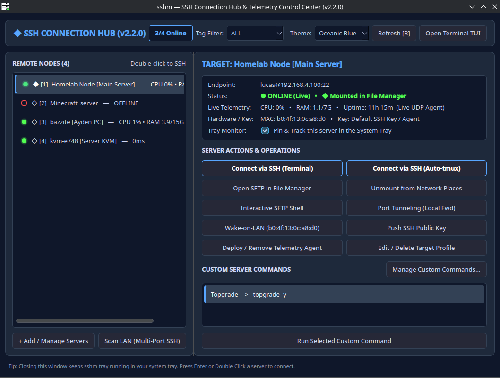
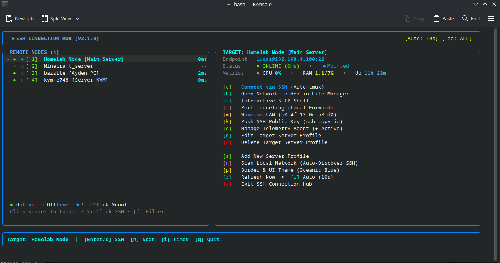

# ◆ sshm — SSH Connection Hub & Telemetry Control Center (v2.2.0)

A fast, unified **Hybrid Linux Desktop Utility** for managing SSH servers, mounting remote SFTP folders, scanning local networks, and monitoring live server CPU/RAM telemetry.

**`sshm`** gives you three ways to work from a single shared configuration:

1. **Desktop GUI Control Center (`sshm-gui`):** A dual-pane PyQt6 control center with 8 built-in color themes, 1-click actions, and live node inspection.
2. **Lightweight System Tray Monitor (`sshm-tray`):** Sits quietly in your panel, tracks only the servers you pin, and opens the GUI instantly when clicked.
3. **Interactive Terminal TUI (`sshm`):** A zero-dependency Bash terminal interface for when you are already working in a shell or connecting remotely.

---

## Screenshots

### Desktop GUI Control Center & System Tray (`sshm-gui` / `sshm-tray`)


> *Tip: Place your GUI screenshot at `screenshots/gui-preview.png` (or update the path above).*

### Terminal User Interface (`sshm`)


> *Tip: Place your TUI screenshot at `screenshots/tui-preview.png` (or update the path above).*

---

## Key Features

* **Unified Hybrid Architecture:** The GUI Control Center, System Tray monitor, and Terminal TUI all read and write to the exact same configuration files (`~/.ssh_servers`, `~/.ssh_custom_commands.json`, and `/dev/shm/sshm_telemetry.json`). Changes made in one appear in the others immediately.
* **Selective Tray Pinning:** Keep your full fleet of servers, test VMs, and containers inside the GUI/TUI while choosing *only* specific production or homelab nodes to be polled and displayed in your system tray (`[Tray+GUI]` vs `[GUI Only]`).
* **Live UDP Telemetry Agent:** Optional 1-click deployment of a tiny, zero-dependency Python systemd user service (`sshm-agent.service` with `loginctl enable-linger`) on remote Linux hosts. Broadcasts live **CPU %**, **RAM usage**, and **Uptime** over UDP port `55889` directly to your desktop.
* **Multi-Port LAN SSH Scanner:** Scans your local `/24` subnet across standard and custom ports (`22, 2222, 2200, 22222, 8022` or custom port ranges), verifies actual `SSH-2.0` banners, and automatically grabs hardware MAC addresses from your ARP table.
* **Universal Cross-Desktop SFTP Mounting:** Mounts and unmounts remote folders across **KDE Dolphin** (`remote:/` Network view and left Places sidebar via `user-places.xbel`), **GNOME Files / Nautilus**, **Thunar**, **Nemo**, **Caja** (`~/.config/gtk-3.0/bookmarks`), and `~/Network_Servers`.
* **Native Default Terminal Detection:** Automatically detects and launches SSH sessions in your desktop environment's configured default terminal (supports **Konsole**, **Ghostty**, **Ptyxis**, **GNOME Terminal / Console**, **XFCE4 Terminal**, **Kitty**, **Alacritty**, **WezTerm**, and **Cosmic Terminal**).
* **Power-User Toolkit Built In:**
  * **1-Click SSH & Auto-`tmux`:** Connect normally or automatically attach/create a persistent `tmux` session.
  * **Local Port Tunneling:** Guided dialog to forward local ports (`localhost:LPORT -> remote:RPORT`).
  * **Custom Server Commands:** Save per-server shell commands (like `topgrade`, `docker ps`, or system updates) and trigger them from the GUI or tray menu.
  * **Wake-on-LAN & SSH Key Pushing:** Send magic packets using saved MAC addresses or push public keys (`ssh-copy-id`) in one click.
* **8 Shared Color Themes:** Switch between *Royal Purple*, *Cyber Neon*, *Matrix Green*, *Solar Amber*, *Crimson Red*, *Oceanic Blue*, *Rose Pink*, and *Stealth Slate*.

---

## Installation

The universal installer sets up the application inside standard user-level FreeDesktop/XDG directories (`~/.local/share/sshm` and `~/.local/bin`), installs the custom scalable SVG icon, creates your desktop launcher entry, and configures login autostart. It works across **Fedora**, **Bazzite / Silverblue**, **Ubuntu / Debian**, **Arch / CachyOS**, and **openSUSE**.

```bash
git clone https://github.com/yourusername/sshm.git
cd sshm
chmod +x install.sh
./install.sh
```

### Uninstalling

To stop the background monitor and cleanly remove all installed binaries, icons, and `.desktop` shortcuts (while keeping your `~/.ssh_servers` profile data safe):

```bash
./install.sh --uninstall
```

---

## Usage & Launch Modes

Once installed, you can launch **SSH Connection Hub** from your desktop's Application Launcher (under **Internet** or **System**), by clicking the system tray icon, or from any terminal:

| Command | Description |
| :--- | :--- |
| **`sshm-gui`** | Opens the **Desktop GUI Control Center** immediately (or brings the existing instance to the front). |
| **`sshm-tray`** | Starts silently in the **System Tray** with zero window overhead. Left-click the tray icon anytime to open the GUI. |
| **`sshm-tray --no-tray`** | Runs the GUI Control Center as a standalone desktop window without a system tray icon. |
| **`sshm`** | Launches the interactive **Terminal TUI** directly inside your current terminal shell. |

---

## Configuration & File Locations

All user data is stored in simple, human-readable files in your home directory:

* **`~/.ssh_servers`** — Pipe-delimited (`|`) server list: `Name|User|Host|Port|Tag|MAC|KeyPath`
* **`~/.ssh_custom_commands.json`** — Per-server custom shell commands and labels
* **`~/.ssh_tray_hidden.json`** — List of servers set to `[GUI Only]` (hidden from background tray polling)
* **`~/.ssh_hub_theme`** — Active theme index (`0`–`7`) shared between the GUI and TUI
* **`/dev/shm/sshm_telemetry.json`** — In-memory RAM disk cache for live UDP node telemetry

---

## AI Assistance Disclaimer

This project was developed with the assistance of AI tools for code generation, PyQt6 GUI layout design, cross-desktop compatibility, and documentation. All features, system integrations, and workflows were directed, tested, and verified on real hardware to ensure reliable day-to-day operation.
